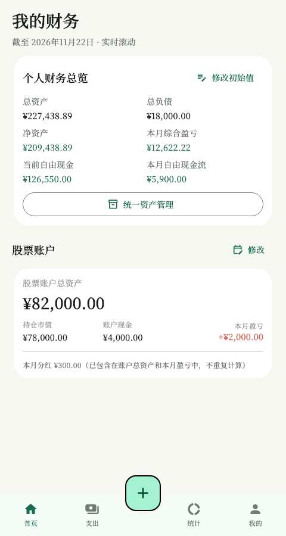
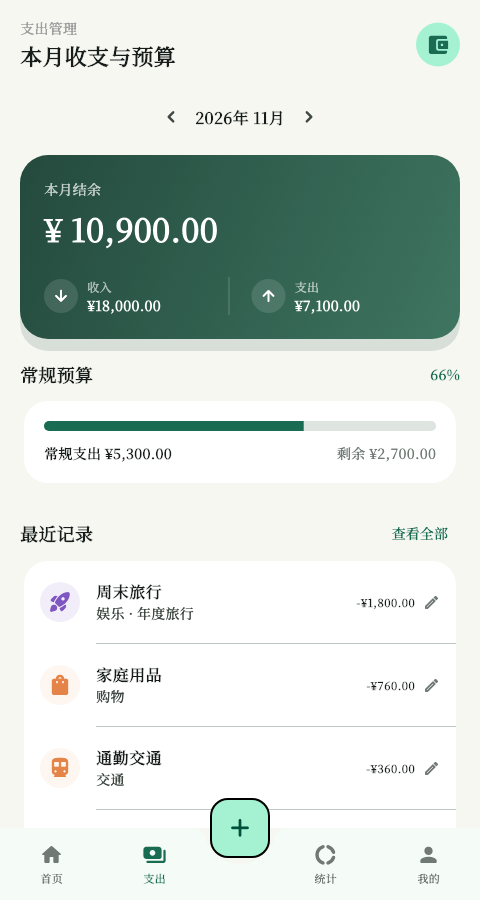
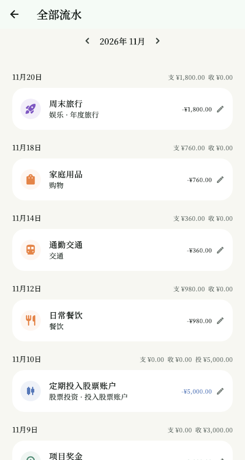
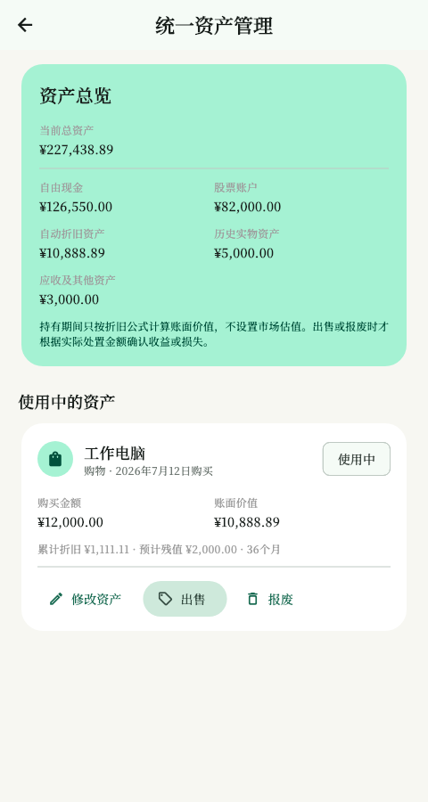
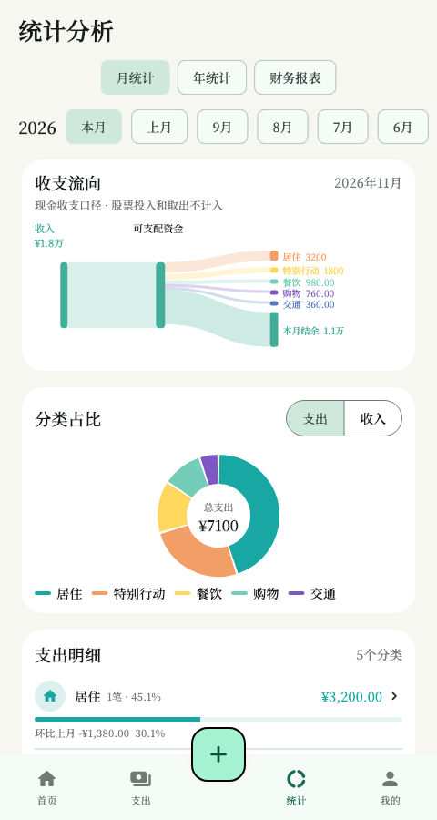
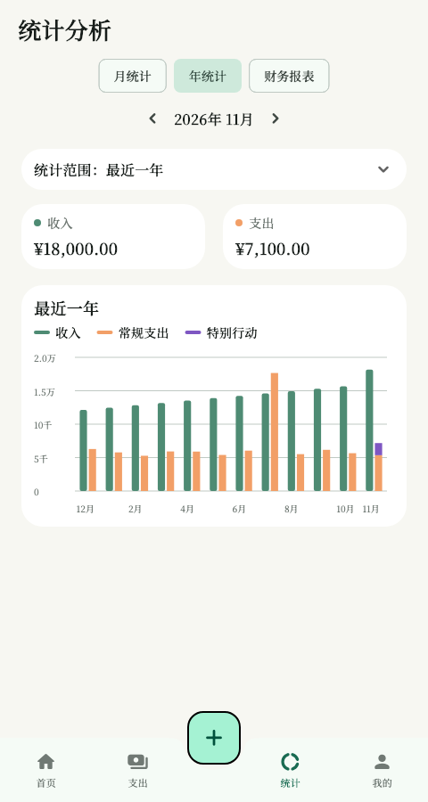
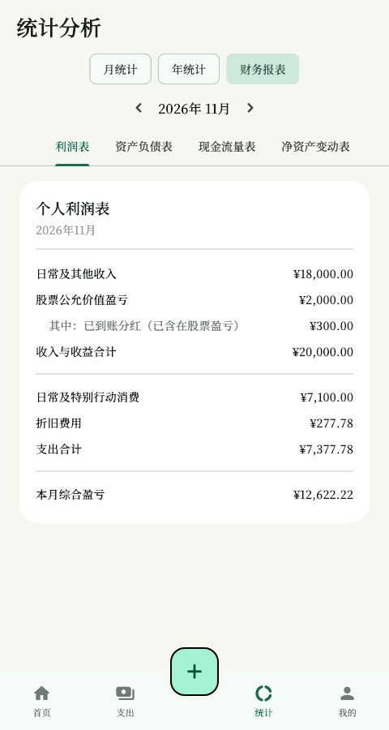
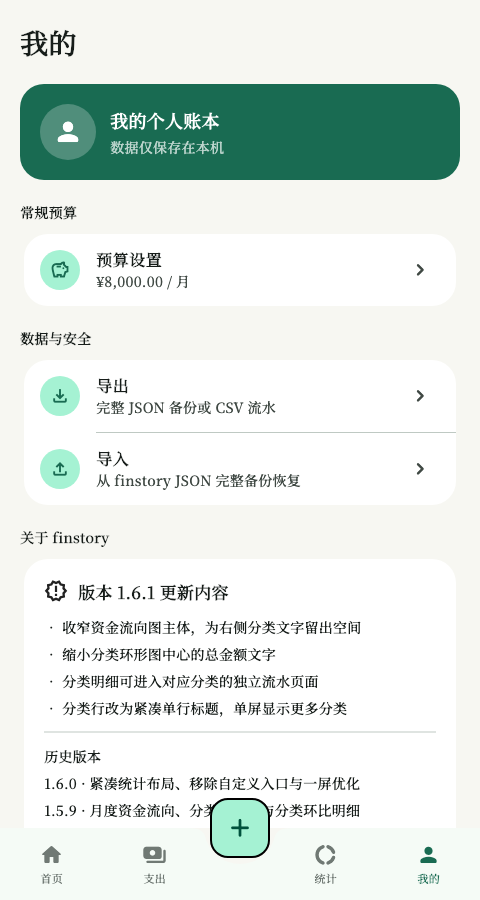
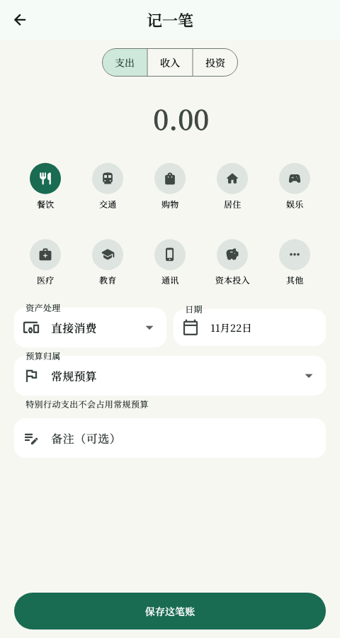

# finstory

<p align="center">
  
</p>

一款面向个人使用、离线优先的 Android 记账与财务状况统计应用。finstory 不仅记录日常收支，还把自由现金、股票账户、折旧资产和负债放进同一套持续滚动的个人账本，并生成接近公司财务披露结构的个人财务报表。

当前版本：`1.6.1+20`

## 界面预览与功能说明

<table>
  <tr>
    <td colspan="2" align="center">
      
      <br><strong>个人财务总览与股票账户</strong>
      <br>实时汇总总资产、总负债、净资产、综合盈亏、自由现金与自由现金流；股票账户展示持仓市值、账户现金、月度盈亏和分红，并可进入统一资产管理。
    </td>
  </tr>
  <tr>
    <td width="50%" align="center">
      
      <br><strong>月度收支与预算</strong>
      <br>按月份查看收入、支出和结余，通过进度条掌握常规预算使用情况；特别行动单独核算，不挤占基础预算，最近记录可直接修改。
    </td>
    <td width="50%" align="center">
      
      <br><strong>全部流水</strong>
      <br>按日期展示收入、支出、股票投入与取出，每日标题同步汇总资金方向；点击记录可修改，左滑可删除。
    </td>
  </tr>
  <tr>
    <td width="50%" align="center">
      
      <br><strong>统一资产管理</strong>
      <br>统一展示自由现金、股票账户、历史实物资产和折旧资产；逐项查看购买金额、账面价值、累计折旧及残值，并支持修改、出售或报废。
    </td>
    <td width="50%" align="center">
      
      <br><strong>月统计</strong>
      <br>资金流向图呈现收入如何流向各类支出与结余；分类环形图支持收入/支出切换，并展示金额、笔数、占比及上月环比。
    </td>
  </tr>
  <tr>
    <td width="50%" align="center">
      
      <br><strong>年统计与长期趋势</strong>
      <br>柱状图对比每月收入、常规支出和特别行动，可切换半年、最近一年、3 年、5 年或从开始至今。
    </td>
    <td width="50%" align="center">
      
      <br><strong>个人财务报表</strong>
      <br>基于实时账本生成个人利润表、资产负债表、现金流量表和净资产变动表，使个人财务状况具备接近公司披露的结构。
    </td>
  </tr>
  <tr>
    <td width="50%" align="center">
      
      <br><strong>数据与设置</strong>
      <br>设置常规预算，导出 JSON 完整备份或 CSV 流水，从 JSON 恢复数据，并查看当前版本与历史更新。
    </td>
    <td width="50%" align="center">
      
      <br><strong>新增与编辑记录</strong>
      <br>支持支出、收入和投资三种类型；可选择分类、资产处理、日期、预算归属和备注，也可使用同一页面修改已有记录。
    </td>
  </tr>
</table>

> 以上界面由 `finstory 1.6.1` 在手机尺寸下使用演示数据直接渲染，不包含真实个人财务信息。

## Target

### 产品目标

- 为单一用户提供长期、连续、可追溯的个人财务记录。
- 初始化一次资产与负债后，由后续流水实时更新自由现金、总资产和净资产。
- 区分消费、资产购置和账户间资金划转，避免把股票投入误算成费用。
- 用月末股票账户快照确认持仓价值及真实投资盈亏。
- 以个人利润表、资产负债表、现金流量表和净资产变动表呈现整体财务状况。
- 数据默认只保存在设备本地，不依赖账号、服务器或网络。

### 目标平台

- 主要交付平台：Android APK
- Android application ID：`com.yohji.ledger_app`（为保证覆盖升级与数据延续而保留）
- Android 最低版本：Android 7.0 / API 24
- 当前 target SDK：API 36
- 仓库保留 Flutter 自动生成的 iOS、Web、macOS、Windows 和 Linux 工程，但目前未作为正式发布目标维护。

### 非目标

- 不提供银行、券商或支付平台自动同步。
- 不提供云端多设备同步或多人协作。
- 不替代专业会计、税务申报或证券交易软件。

## 功能

### 记账与预算

- 支出、收入、投资三种独立流水类型。
- 支出与收入分类、日期和备注。
- 最近记录和全部流水均可点击修改金额、类别及其他记录信息。
- 按月份切换、按日期分组查看全部流水，并支持左滑删除。
- 常规月度预算及预算使用进度。
- “特别行动”独立预算，例如旅行或大宗购物，不占用常规预算。
- 首次安装为空账本，不自动添加示例数据。

### 投资与股票账户

- 股票投资不计入收入或支出。
- “投入”：自由现金转入股票账户现金。
- “取出”：股票账户现金转回自由现金。
- 投入和取出只改变资产所在账户，不直接改变总资产、净资产或利润。
- 月末记录持仓市值和证券账户现金。
- 根据上月快照、期间投入和取出自动计算股票账户月度盈亏。
- 记录实际到账分红和手续费税费；分红已包含在证券账户资产及股票盈亏中，不重复确认。
- 兼容旧版本中作为“支出／股票投资”保存的流水，并自动迁移为“投资／投入”。

### 资产与折旧

- 一次性初始化现金、实物资产、其他资产和负债。
- 收入、支出和投资流水实时更新当前自由现金。
- 可将手机、电脑等购买记录为折旧资产。
- 支持折旧期限和预计残值，从购买后的下一个自然月开始按直线法计提折旧。
- 首页提供统一资产管理，集中展示现金、股票账户、历史实物资产和逐项折旧资产。
- 持有期间仅计算账面价值；出售或报废时根据实际处置金额确认处置收益或损失。
- 出售折旧资产时，根据售价与账面价值自动确认处置收益或损失。

### 统计与个人财务报表

- 月度收入、支出和预算概览，并以资金流向图展示收入、支出和结余。
- 支出/收入分类环形图、分类金额、笔数、占比及上月环比。
- 点击分类明细进入该分类的独立流水页，可继续修改金额、类别和其他信息。
- 月度柱状趋势，区分基础支出和特别行动支出。
- 年统计内可直接切换半年、最近一年、3 年、5 年和从开始至今，无需单独的自定义入口。
- 统计图、财务总览与股票账户采用紧凑排版，在常见手机屏幕上展示更多完整内容。
- 个人利润表。
- 个人资产负债表。
- 个人现金流量表。
- 个人净资产变动表。

### 数据与隐私

- 使用设备本地存储，无需登录和联网。
- 支持完整 JSON 备份与恢复。
- 支持 CSV 流水导出。
- JSON 备份包含流水、预算、特别行动、股票快照和财务初始值。
- 相同 application ID 与签名的新版 APK 可覆盖安装并保留本地数据。

> 本项目不会把个人财务数据上传到服务器。卸载 App 会清除设备上的应用数据，升级或更换设备前建议先导出 JSON 备份。

## 技术栈

| 层级 | 技术 | 用途 |
| --- | --- | --- |
| UI | Flutter、Material 3 | 跨平台界面、浅色/深色主题及响应式布局 |
| 语言 | Dart 3 | 业务模型、财务计算、页面与状态逻辑 |
| 状态管理 | `ChangeNotifier` | 单用户本地账本状态与界面刷新 |
| 本地存储 | `shared_preferences` + JSON | 流水、预算、快照与财务初始值持久化 |
| 文件导入 | `file_selector` | 选择并读取 JSON 备份文件 |
| Android 原生层 | Kotlin、MethodChannel、FileProvider | 调用 Android 分享面板导出 JSON/CSV 文件 |
| Android 构建 | Gradle、Android Gradle Plugin、JDK 17+ | Release APK 编译与签名 |
| 测试 | `flutter_test` | Widget 测试、数据持久化与财务计算测试 |

核心依赖以 [`pubspec.yaml`](pubspec.yaml) 为准。

## 数据与计算原则

```text
收入 ────────────────→ 自由现金增加 ─→ 净资产增加
消费支出 ────────────→ 自由现金减少 ─→ 当期费用增加
折旧资产购买 ────────→ 现金转为实物资产 ─→ 按月确认折旧费用
股票投入 / 取出 ─────→ 自由现金 ⇄ 股票账户 ─→ 总资产不变
月末股票账户快照 ────→ 确认持仓与账户现金 ─→ 计算投资盈亏
```

股票账户月度盈亏的核心逻辑：

```text
本月股票盈亏
= 本月末股票账户总资产
- 上次快照股票账户总资产
- 期间投入
+ 期间取出
```

第一条股票快照作为计算基准，不确认历史盈亏。

## 项目结构

```text
lib/
├── data/
│   └── ledger_store.dart             # 本地存储与核心财务计算
├── models/
│   ├── financial_baseline.dart       # 初始资产负债
│   ├── financial_position_snapshot.dart
│   ├── ledger_entry.dart             # 收入、支出与投资流水
│   ├── special_action.dart            # 特别行动
│   └── stock_monthly_snapshot.dart   # 股票账户月度快照
├── screens/
│   └── ledger_shell.dart             # 主要页面和交互
├── theme/
│   └── app_theme.dart                # Material 3 主题
└── main.dart                         # 应用入口
```

## 本地开发

### 环境要求

- Flutter SDK（当前项目使用 Dart SDK `^3.13.7`）
- Android SDK
- JDK 17 或更高版本

检查开发环境并安装依赖：

```bash
flutter doctor
flutter pub get
```

运行应用：

```bash
flutter run
```

## 检查与测试

```bash
flutter analyze
flutter test
```

当前自动化测试覆盖：

- 首页、导航、记账和月度趋势界面。
- 常规预算与特别行动预算隔离。
- 投资投入/取出的现金及资产联动。
- 股票快照、分红和月度盈亏计算。
- 折旧资产、资产出售及处置损益。
- 初始资产后的跨月滚动计算。
- JSON 备份恢复、CSV 导出和旧数据迁移。

## 构建 Android APK

```bash
flutter build apk --release
```

生成文件：

```text
build/app/outputs/flutter-apk/app-release.apk
```

## Release 签名与数据延续

项目使用固定的个人 Release 签名，使后续 APK 可以直接覆盖安装并保留应用数据。以下文件属于私人密钥，不得提交到 GitHub：

```text
android/key.properties
android/app/signing/personal-release.jks
```

这些文件已被 `.gitignore` 排除。请在安全位置单独备份；如果签名丢失，未来构建的 APK 将无法覆盖已安装版本。

发布新版本时需要：

1. 更新 `pubspec.yaml` 中的版本名称和 build number。
2. 使用同一个 application ID 和 Release 签名。
3. 运行测试并构建 Release APK。
4. 安装新 APK 时不要先卸载旧版本。

## 许可

这是一个个人项目，目前未附加开源许可证。未经明确授权，不表示允许复制、分发或用于商业用途。
